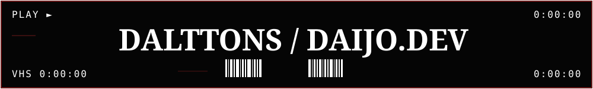

<!-- BANNER VHS PRINCIPAL -->

 

<!-- LAYOUT PRINCIPAL DE 2 COLUMNAS -->
<table width="100%" border="0" cellspacing="0" cellpadding="0">
<tr>
<!-- COLUMNA IZQUIERDA: INFO, STACK & PROYECTOS -->
<td width="55%" valign="top">

<h3>✦ ABOUT ME</h3>

Hi, I'm Dalttons — a Communication Sciences student fascinated by Human-Machine Communication (HMC), AI, and the ways people perceive and relate to intelligent machines. I also enjoy vibe coding and building creative digital experiences.

<code>[ IDLE ]</code> <kbd>[ ACTIVE ]</kbd>

 

<h3>✦ TECH STACK & TOOLS</h3>

 

<h3>✦ HIGHLIGHTED PROJECTS</h3>
<table width="100%" border="0" cellspacing="0" cellpadding="4">
<tr>
<td width="50%">

</td>
<td width="50%">

</td>
</tr>
</table>

</td>

<!-- ESPACIADOR -->
<td width="3%"></td>

<!-- COLUMNA DERECHA: ASCII + REDES SOCIALES -->
<td width="42%" valign="top" align="center">

  

<code>🔗 connect with me 🔗</code>

</td>
</tr>
</table>

<!-- SECCIÓN INFERIOR (SCROLL): STATS & LENGUAJES -->
<table width="100%" border="0" cellspacing="0" cellpadding="0">
<tr>
<td width="50%" valign="top">

</td>
<td width="50%" valign="top">

</td>
</tr>
</table>
